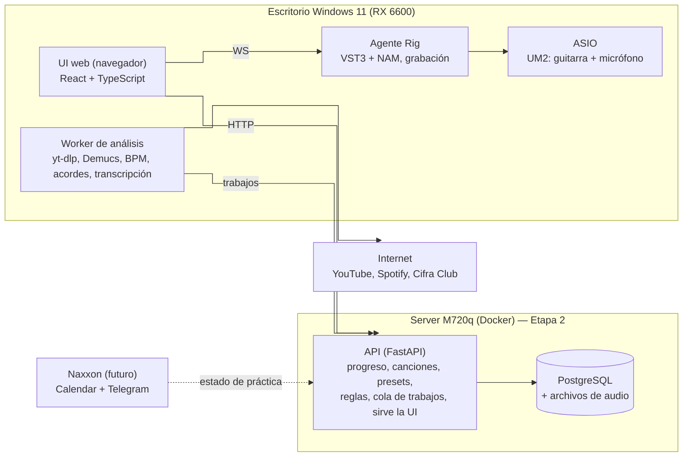
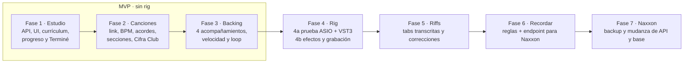

# Plan — App de Práctica de Guitarra

Actualizado: 2026-10-20 · Juan Pedro

## Resumen

App personal para practicar guitarra clásica y eléctrica: una sección **Estudio** con clases progresivas de eléctrica, una sección **Explorar** que convierte un link de YouTube o Spotify en material de práctica (acordes, rasgueos, riffs, acompañamiento), y un **Rig** local para escucharse con efectos y grabar voz + guitarra. Por ahora todo corre en la PC de escritorio con Windows 11; más adelante la base y la API se mudan al server casero (Naxxon, ThinkCentre M720q), que primero hace de backup.

**Usuario:** un solo usuario (Juan Pedro), 10 meses de guitarra. Sabe acordes, rasgueos y cejilla; es novato en escalas, punteo y teoría. Gustos: rock argentino (Calamaro, Charly, Cerati, Babasónicos), classic rock, new wave / dream pop (The Cure).

**Cambio de entorno (oct. 2026):** el escritorio pasó de Ubuntu a **Windows 11, de forma definitiva**. El código de la primera Fase 0 (rig en Linux) se perdió porque no estaba pusheado, y además dependía de PipeWire, mod-host y systemd; se arranca de cero. Naxxon sigue con Ubuntu Server pero todavía no está operativo, así que todo se desarrolla y corre primero en Windows. El orden cambia: **MVP primero (Estudio, progreso, Explorar con análisis y acompañamiento), rig después**.

**Objetivos**

1. Practicar todos los días con una sesión guiada y ver el progreso (días, racha, ejercicios completados).
2. Pegar un link y tener todo lo necesario para tocar esa canción, en clásica o eléctrica.
3. Sonar "con onda" en eléctrica: efectos aproximados al tema, activables con un botón.
4. Grabarse (voz + guitarra) sin depender de un DAW.

### Instrucciones para el agente implementador (Claude Opus)

- Implementar **por fases, en orden**. No empezar una fase sin que la anterior cumpla sus criterios de aceptación. La metodología de trabajo está en `CLAUDE.md`.
- El **MVP (Fases 1 a 3) no depende del rig** y va primero. El rig arranca en la Fase 4 con una prueba de audio (4a) que bloquea el resto del rig: si falla, se cambia de herramienta antes de construir encima. Guitarix queda descartado.
- Buenas prácticas: Clean Code, principios SOLID, tests automatizados por módulo, commits chicos. Registrar cada decisión técnica en `docs/adr/` (un ADR por decisión).
- Todo reproducible: en el escritorio la app se levanta con `docker compose up` (API + Postgres + UI) y un script PowerShell idempotente (`install.ps1`) para el worker y el Rig. Mientras la base viva en el escritorio, un `pg_dump` manual antes de cambios grandes alcanza; el backup automático en Naxxon llega en la Fase 7.
- **Repo en GitHub (privado) desde el primer commit, con push al cerrar cada tarea.** La versión anterior se perdió por no estar pusheada.
- Entorno Windows: Python 3.12 nativo con venv para worker y Rig; Docker Desktop (backend WSL2) para API + Postgres + UI. Rutas con `pathlib`, nunca separadores fijos. `.gitattributes` con `* text=auto eol=lf` y `*.ps1 eol=crlf`.
- Si una decisión de este plan resulta inviable, documentar por qué en un ADR y proponer la alternativa; no improvisar en silencio.
- Idioma de la UI: español rioplatense.

## Alcance funcional

La app tiene cinco áreas; todas conviven en una misma UI, pero el Rig solo aparece cuando el agente de audio local está disponible.

### 1. Estudio (clases de eléctrica)

- Currículum de **niveles progresivos**, cada uno con lecciones y ejercicios. Punto de partida sugerido (el agente puede refinarlo): power chords y palm mute → pentatónica menor (caja 1, luego 2) → ligados (hammer-on, pull-off, slide) → bends y vibrato → blues en La → conectar cajas → escala mayor y pentatónica mayor → arpegios → teoría aplicada (intervalos, grados, armonía de la escala mayor) → improvisación y composición de riffs.
- Cada ejercicio tiene: explicación corta, diagrama de mástil, tablatura animada, tempo objetivo y tempo de arranque, y un **check "Terminé"**.
- Modos de reproducción: automático al tempo elegido y **nota por nota** (avanza cuando el usuario toca "siguiente").
- **Sesión del día**: la app arma una sesión de ~20 min (calentamiento + técnica + riff + improvisación) según el nivel actual y lo pendiente.
- Teoría: lecciones cortas e interactivas (qué es una tónica, un grado, un intervalo), siempre atadas a algo que se toca.
- Sin corrección por audio: el usuario se autoevalúa.

### 2. Explorar (canciones)

- Input: link de **YouTube o Spotify**, o nombre + artista.
- Selector de instrumento: **clásica** o **eléctrica**.
- Resultado por canción: BPM, tonalidad, estructura por secciones (intro, estrofa, estribillo…), acordes por sección con diagramas (incluida cejilla), rasgueo sugerido por sección, **riffs en tablatura** cuando los hay, y arpegios opcionales para clásica.
- Cada canción se puede partir en **ejercicios** ("riff de la intro a 80 bpm", "cambio de acordes del estribillo") que suman al progreso igual que los de Estudio.
- **Acompañamiento** con selector (el usuario elige):
  1. Metrónomo / batería al BPM detectado.
  2. El audio original sincronizado, con **velocidad regulable sin cambiar el tono** y loop de una sección.
  3. El original **sin la guitarra** (separación de pistas; marcado como experimental).
  4. Backing generado: batería + bajo + acordes.
- **Correcciones**: el usuario puede editar acordes, rasgueos y tabs; su versión queda como la verdad para esa canción y alimenta el aprendizaje (ver Pipeline).

### 3. Rig (solo eléctrica, solo en el escritorio)

- Monitoreo de la guitarra con efectos en tiempo real, baja latencia, vía la Behringer UM2.
- **Preset automático por canción** (aproximado) + selector manual de una biblioteca de presets + **botón on/off** de efectos.
- **Grabación**: pista de voz (micrófono BM-800 en la entrada XLR con phantom) + pista de guitarra con efectos; además, una pista oculta de guitarra limpia (DI) para poder cambiar efectos después. Sin edición multipista: grabar, escuchar, exportar.
- Se puede grabar mientras suena el acompañamiento.

### 4. Progreso

- Día de práctica = al menos un ejercicio marcado como "Terminé".
- Métricas: racha actual y máxima, días practicados (calendario tipo heatmap), ejercicios completados por nivel, mejor BPM por ejercicio, canciones en curso.
- Todo se guarda en la base de la app (en el escritorio hasta la Fase 7); se empieza de cero (no se migra nada de los artefactos anteriores).

### 5. Recordatorios (vía Naxxon, a futuro)

- La app de guitarra **expone** el estado de práctica y las reglas; **no** manda mensajes ella misma.
- Reglas configurables: días excluidos (ej. lunes), umbral de inactividad (ej. 2 días sin practicar → sugerir hoy o mañana).
- Naxxon (todavía no existe) consultará ese endpoint, buscará huecos libres en Google Calendar y avisará por Telegram ("a la tarde tenés libre, te falta el riff de X"). En este proyecto solo se implementa y documenta el contrato.

## Arquitectura

Cuatro piezas propias, desplegadas en dos etapas. Etapa 1 (ahora): todo corre en la PC de escritorio con Windows 11 — API, Postgres, UI, worker y agente Rig. Etapa 2 (Fase 7): la API y la base se mudan a Naxxon y el escritorio queda con el worker y el Rig, conectados al server por la red. El diagrama muestra la Etapa 2. El audio en tiempo real nunca pasa por la red.



**Qué corre en vivo y qué no:** mientras se toca, el camino es solo guitarra → UM2 → ASIO → cadena de efectos con el preset ya cargado → auriculares. **En vivo no corre ningún LLM ni análisis**: la elección de preset y todo el análisis de la canción pasan antes, una sola vez. NAM es una red neuronal chica que se comporta como un pedal más (procesa la señal, no decide nada) y corre en CPU. Mientras el Rig está activo, el worker no debe procesar trabajos pesados en la misma PC (pausa automática o cola en espera).

El worker no toca la base: pide trabajos a la API y le devuelve resultados, así el escritorio no necesita credenciales de la base. Si el escritorio está apagado, los trabajos esperan en cola.

**Mudanza barata desde el día 1.** UI, worker y Rig hablan con la API solo por una URL configurable (`GUITAR_API_URL`) y un token, nunca con la base directamente. La base es Postgres también en el escritorio, así la mudanza es mover el contenedor y no cambiar de motor. Audio cacheado y grabaciones van en rutas configurables. Mudar = levantar el mismo compose en Naxxon, restaurar un dump y cambiar la URL; cero cambios de código.

| Pieza | Dónde | Tecnología propuesta | Notas |
| --- | --- | --- | --- |
| API | Escritorio (Docker Desktop); Naxxon en Etapa 2 | Python 3.12, FastAPI, SQLAlchemy + Alembic | Cola de trabajos como tabla en Postgres (sin Redis) para simplificar. |
| Base | Escritorio (Docker Desktop); Naxxon en Etapa 2 | PostgreSQL 16 + volumen para audio y stems | Audio cacheado reinicializable; lo valioso es progreso y correcciones. |
| UI web | Servida por la API, usada en el escritorio | TypeScript, React, Vite; SVG para mástil y tabs; Tone.js / Web Audio para metrónomo y backing | Diseñada responsive desde el día 1 para sumar Mac y celular después. |
| Worker | Escritorio | Python; yt-dlp, ffmpeg, Demucs, librerías de BPM, acordes y transcripción (ver Pipeline) | Python nativo en Windows (venv). CPU por defecto: ROCm en Windows no es confiable con la RX 6600; el agente puede evaluar aceleración por GPU y documentarla en un ADR. Arranca al iniciar sesión (Programador de tareas). |
| Agente Rig | Escritorio | Python nativo en Windows (nunca en Docker), arranca al iniciar sesión, WebSocket en localhost | Audio por ASIO; cadena de efectos VST3 con NAM; host elegido por medición de latencia. Ver Rig. |

**Por qué worker y Rig no van en Docker:** en Windows, Docker corre dentro de una máquina virtual Linux (WSL2) que no ve el driver ASIO de la UM2 ni la GPU de forma útil. API, Postgres y UI sí van en contenedores, que es lo que después se muda a Naxxon sin cambios.

**Acceso y seguridad:** en la Etapa 1, API y base publicadas solo en 127.0.0.1 del escritorio. En la Etapa 2, solo LAN y Tailscale, nada expuesto a internet. Un token estático por dispositivo alcanza (un solo usuario). Sin datos sensibles.

**Diseño multi-dispositivo:** la UI detecta si el agente Rig responde en localhost; si no, oculta las funciones de Rig y reproduce el acompañamiento por el navegador. Así la misma UI sirve en la Mac o el celular sin cambios.

## Modelo de datos

Una sola base PostgreSQL con estas entidades; el agente define tipos y restricciones exactas en las migraciones.

| Entidad | Campos clave | Notas |
| --- | --- | --- |
| `Level` | id, orden, nombre, descripción, instrumento | Niveles del currículum de Estudio. |
| `Lesson` | id, level_id, orden, título, contenido teórico (markdown) | Teoría corta + ejercicios. |
| `Exercise` | id, lesson_id o song_section_id, tipo, instrumento, notación, bpm_inicio, bpm_objetivo, duración_min | Un ejercicio pertenece a una lección **o** a una sección de canción. Tipos: escala, riff, acordes, rasgueo, arpegio, técnica, improvisación. |
| `ExerciseCompletion` | id, exercise_id, fecha_hora, bpm_logrado, instrumento | El "Terminé". Define los días de práctica. |
| `PracticeSession` | id, fecha, ejercicios planificados, estado | Sesión del día armada por la app. |
| `Song` | id, título, artista, fuente (youtube/spotify), url, youtube_id, duración, bpm, tonalidad, estado_análisis | Una por canción, independiente del instrumento. |
| `SongSection` | id, song_id, nombre, inicio_s, fin_s, orden | Intro, estrofa, estribillo… con tiempos. |
| `SongChart` | id, song_id, instrumento, versión, origen (auto / cifraclub / usuario), acordes por sección, rasgueos, riffs, arpegios, confianza | Versionado: la última de origen `usuario` gana. |
| `AudioAsset` | id, song_id, tipo (original, sin_guitarra, stems…), ruta, formato | Archivos en el volumen de la app (escritorio; Naxxon en Etapa 2). |
| `AnalysisJob` | id, song_id, tipo, estado, intentos, error, creado, tomado_por | Cola que consume el worker. |
| `EffectPreset` | id, nombre, estilo, cadena (JSON de plugins + parámetros), modelo_nam, ir_caja, tags | Biblioteca curada. |
| `SongPreset` | song_id, preset_id, origen (auto / usuario), confianza | La elección del usuario pisa a la automática. |
| `Recording` | id, song_id?, fecha, pistas (voz, guitarra_fx, guitarra_di), duración, preset_id | WAV en el escritorio (copia en Naxxon desde la Fase 7). |
| `ReminderRules` | días_excluidos, umbral_inactividad_días, franja_horaria_preferida | Fila única; la consume Naxxon. |
| `Settings` | tema (tokens de color), afinación, zona horaria (IANA, default America/Montevideo), instrumento por defecto, dispositivo ASIO, canales de entrada, latencia/buffer | Fila única. |
| `Correction` | id, song_chart_id, qué cambió (diff), fecha | Historial para el aprendizaje. |

### Formato interno de notación

Todo lo que se toca (escalas, riffs, arpegios, acordes, rasgueos) se guarda en **un único formato JSON** que la UI renderiza como mástil y tablatura. El pipeline, el currículum y las correcciones producen este mismo formato.

```json
{
  "tuning": ["E2","A2","D3","G3","B3","E4"],
  "bpm": 90,
  "time_signature": "4/4",
  "events": [
    {"t": 0.0, "dur": 0.5, "string": 6, "fret": 5, "technique": null},
    {"t": 0.5, "dur": 0.5, "string": 6, "fret": 7, "technique": "h"},
    {"t": 1.0, "dur": 1.0, "string": 5, "fret": 7, "technique": "b", "bend": 1}
  ],
  "chords": [{"t": 0, "name": "Am", "shape": ["x",0,2,2,1,0], "barre": null}],
  "strum": [{"t": 0, "pattern": "D-DU-UDU", "accent": [0, 4]}],
  "tonic": "A"
}
```

`t` y `dur` en tiempos (beats). Técnicas: `h` hammer-on, `p` pull-off, `/` `\` slide, `b` bend, `r` release, `~` vibrato, `pm` palm mute, `x` muteada.

## Contratos de API

REST en JSON bajo `/api/v1`, documentado con OpenAPI (lo genera FastAPI). El agente completa los esquemas; estos son los endpoints mínimos.

| Método y ruta | Uso |
| --- | --- |
| `GET /levels`, `GET /levels/{id}/lessons`, `GET /lessons/{id}` | Currículum de Estudio. |
| `GET /exercises/{id}` | Ejercicio con su notación. |
| `POST /exercises/{id}/complete` | Marca "Terminé" (body: bpm_logrado, instrumento). |
| `GET /sessions/today`, `POST /sessions/today/regenerate` | Sesión del día. |
| `GET /progress/summary` | Racha, máximo, días practicados, avance por nivel. |
| `GET /progress/calendar?from&to` | Días practicados para el heatmap. |
| `POST /songs` | Body: `{url}` o `{title, artist}`. Crea la canción y encola el análisis. Idempotente por youtube_id. |
| `GET /songs`, `GET /songs/{id}` | Biblioteca y detalle con estado del análisis. |
| `GET /songs/{id}/chart?instrument=electric` | Acordes, rasgueos, riffs, secciones. |
| `PUT /songs/{id}/chart` | Guarda una corrección del usuario (nueva versión, origen `usuario`). |
| `GET /songs/{id}/audio/{tipo}` | Audio original o sin guitarra (streaming con range requests). |
| `GET /songs/{id}/preset`, `PUT /songs/{id}/preset` | Preset sugerido y elección manual. |
| `GET /presets` | Biblioteca de efectos. |
| `POST /recordings`, `GET /recordings` | Sube y lista grabaciones. |
| `GET/PUT /settings` | Tema y preferencias. |
| `GET/PUT /reminders/rules` | Reglas de recordatorio. |
| `GET /reminders/status` | **Contrato para Naxxon** (abajo). |
| `POST /jobs/claim`, `POST /jobs/{id}/result`, `POST /jobs/{id}/fail` | Uso exclusivo del worker (token propio). |
| `GET /health` | Salud del servicio. |

### Contrato para Naxxon

`GET /reminders/status` devuelve si hay que recordar y qué sugerir; Naxxon decide **cuándo** según el calendario.

```json
{
  "should_remind": true,
  "reason": "2 días sin practicar",
  "last_practice_date": "2026-09-25",
  "current_streak": 0,
  "excluded_today": false,
  "preferred_window": "tarde",
  "suggested_minutes": 20,
  "suggestions": [
    {"type": "exercise", "title": "Pentatónica caja 2", "target_bpm": 80},
    {"type": "song", "title": "Flaca — Calamaro", "section": "Riff intro"}
  ]
}
```

### Protocolo UI ↔ Agente Rig

WebSocket en `ws://127.0.0.1:<puerto>` con mensajes JSON tipados. Mínimo:

- De UI a Rig: `load_preset`, `set_bypass`, `set_param`, `set_input_gain`, `play_backing` (ruta o URL, posición, velocidad, loop), `stop_backing`, `record_start`, `record_stop`, `get_status`.
- De Rig a UI: `status` (conectado, latencia, cortes, preset activo), `levels` (vúmetros ~20 Hz), `recording_saved` (rutas de pistas), `error`.

El acompañamiento se reproduce **por el Rig** cuando está disponible, para que guitarra y backing compartan el mismo reloj de audio; si no, por el navegador.

## Pipeline de análisis de canciones

El audio da tempo, estructura y tiempos; Cifra Club da los nombres de acordes cuando existe; las correcciones del usuario pisan todo. Cada paso es un módulo independiente con tests y guarda su salida, para poder re-ejecutar solo lo que falle.

### Pasos

1. **Resolver la fuente.** Link de YouTube → metadatos con yt-dlp. Link de Spotify → título, artista y duración vía Spotify Web API (client credentials; el usuario crea una app de desarrollador). Spotify no entrega audio y sus endpoints de audio features y audio analysis están cerrados para apps nuevas desde noviembre de 2024, así que siempre se busca el tema en YouTube y se elige el resultado con duración más parecida (±3 s, desempate por título).
2. **Descargar** el audio con yt-dlp → WAV 48 kHz con ffmpeg. Cachear por youtube_id.
3. **Separar pistas** con Demucs: modelo de 4 pistas para batería, bajo, voz y resto; modelo de 6 pistas para aislar la guitarra. La mezcla "sin guitarra" = suma de todo menos la pista de guitarra. Marcar como experimental: la calidad de la pista de guitarra del modelo de 6 es irregular.
4. **Tempo y compases:** beat tracking → BPM, grilla de beats y primer tiempo de cada compás.
5. **Tonalidad y acordes:** reconocimiento de acordes sobre la mezcla (o pistas armónicas) → línea de tiempo de acordes, ajustada a la grilla de beats.
6. **Estructura:** segmentación por repetición → secciones con tiempos; nombres heurísticos (intro, estrofa, estribillo) que el usuario puede renombrar.
7. **Riffs:** transcripción de notas (tipo basic-pitch) sobre la pista de guitarra, en secciones candidatas (intro, partes con pocas notas simultáneas) → cuantizar a la grilla → **asignación de digitación** (programación dinámica que minimiza saltos de mano y respeta las posiciones que el usuario prefiere) → formato interno de notación. Guardar confianza por evento.
8. **Cruce con Cifra Club:** buscar por título + artista y parsear acordes por sección (y tabs si hay). Alinear la secuencia de Cifra Club con la detectada (distancia de edición); donde coinciden sube la confianza, y se usan los nombres de Cifra Club con los tiempos detectados. El scraper vive en un adaptador aislado: si falla o no encuentra, el pipeline sigue sin él.
9. **Rasgueo (y arpegio en clásica):** no se detecta de forma confiable, así que se **propone**: un catálogo de patrones (rasgueos y arpegios p-i-m-a) + reglas por compás y tempo + densidad de ataques del audio; un LLM local elige del catálogo con salida JSON validada.
10. **Adaptar al instrumento:** clásica → acordes abiertos, sugerir cejilla o capo, arpegios opcionales; eléctrica → opción de power chords, riffs, preset de efectos (ver Rig).
11. **Guardar** un `SongChart` de origen `auto` con confianza por campo. La UI marca en otro color lo de baja confianza.

**Herramientas:** yt-dlp, ffmpeg y Demucs son fijas. Para beat tracking, acordes y transcripción el agente evalúa candidatos (por ejemplo beat_this o madmom; BTC o Chordino; basic-pitch) con 5 canciones de prueba del repertorio del usuario y registra la elección en un ADR. yt-dlp se actualiza seguido porque YouTube cambia: dejar un comando de actualización simple.

**LLM local:** Ollama corre en el escritorio con Windows; con la RX 6600 usa el backend Vulkan, que es el recomendado para las RX 6000 en Windows. Se usa solo para elecciones acotadas (rasgueo del catálogo, preset de la biblioteca, nombres de secciones), siempre con esquema JSON y validación. Nada de generar tabs con el LLM. Nunca se usa en el camino de audio en vivo.

### Cómo "aprende"

No se entrena un modelo al inicio. El aprendizaje es un bucle de correcciones:

1. **Correcciones como verdad:** si el usuario edita acordes, rasgueo o tab, esa versión gana siempre para esa canción.
2. **Preferencias derivadas:** de las tabs corregidas se aprenden las posiciones y formas de acorde que prefiere; esos pesos alimentan la asignación de digitación de las próximas canciones.
3. **Presets:** las elecciones manuales por canción, artista y estilo pesan en las próximas sugerencias.
4. **Dataset para después:** cada par (automático, corregido) queda guardado. Cuando haya volumen, se evalúa un fine-tuning chico (fuera de alcance de este plan).

## Rig de audio

Un agente Python nativo en Windows toma guitarra y micrófono de la UM2 por **ASIO**, procesa la cadena de efectos en **VST3** con Neural Amp Modeler (NAM) como amplificador, y graba. No hay DAW de por medio. Requisitos del usuario: **todo gratis** y **la menor latencia posible**; el host no se elige por preferencia, se elige midiendo.

### Stack de audio

- **Driver ASIO de la UM2:** Behringer ya no ofrece un driver ASIO propio para la UM2 y deriva a ASIO4ALL (gratis), que trabaja sobre el driver USB de Windows. Ese driver fija el piso de latencia para cualquier host, así que la Fase 4a lo mide primero, solo. Si aparece una alternativa gratuita mejor, el agente la prueba y la documenta.
- **Frecuencia 48 kHz** (los modelos NAM suelen estar entrenados a 48 kHz y el plugin no resamplea).
- **Host candidato A, dentro de la app:** `sounddevice` para entrada y salida (el paquete para Windows trae PortAudio con ASIO, que se activa con la variable `SD_ENABLE_ASIO`) + `pedalboard` para cargar los VST3 y procesar cada bloque. Ventaja: un solo proceso, la grabación sale del mismo flujo, nada externo. Riesgo: que Python no sostenga buffers chicos sin cortes.
- **Host candidato B, Carla:** gratis y open source, carga VST2/VST3 y se controla entera por OSC desde el agente Rig. Ventaja: motor de audio en C++. Riesgo: los builds de Windows están menos pulidos que los de Linux.
- **Criterio de elección:** gana el que logre la menor latencia de ida y vuelta **sin cortes durante 10 minutos** con la cadena completa. Si empatan, A (menos piezas). Se registra en un ADR con las mediciones. El protocolo UI ↔ Rig no cambia según el host.
- **Carga del modelo NAM sin interfaz gráfica:** el plugin VST3 de NAM elige el modelo desde su ventana; el host tiene que poder fijarlo por estado o preset guardado del plugin. Validar en 4a.
- **Interfaz Behringer UM2:** entrada 1 XLR con phantom → micrófono BM-800; entrada 2 instrumento → guitarra. El mapeo de canales ASIO es configurable en Settings, no fijo en el código.

### Cadena de efectos (orden fijo)

Noise gate → compresor (opcional) → drive / fuzz → **NAM (amp)** → cargador de IR (caja) → modulación (chorus, flanger, phaser) → delay → reverb → volumen master → **limitador de seguridad** (evita picos en los auriculares).

- Los modelos NAM de solo amplificador necesitan una IR de caja después; la cadena la incluye siempre.
- Efectos de modulación, delay, reverb, gate y limitador: plugins VST3 gratuitos para Windows (el agente elige y documenta cuáles, con su licencia, en un ADR). Nada pago.
- Controles siempre visibles: **on/off de toda la cadena**, ganancia de entrada, volumen master, y on/off por bloque.

### Biblioteca de presets

- Arrancar con **15–20 presets** curados por estilo del repertorio del usuario: clean con chorus (new wave / The Cure, Soda Stereo ochentoso), clean con reverb y delay (dream pop), crunch de rock argentino, overdrive blusero, classic rock de alta ganancia, fuzz, acústico simulado.
- Cada preset = JSON con identificadores de plugins VST3, parámetros, modelo NAM e IR. Los archivos de modelos e IR **no se versionan**: un script los descarga (fuentes como Tone3000) y el agente verifica la licencia de cada uno.
- **Selección automática:** el LLM local recibe título, artista, año y estilo, y elige un preset de la biblioteca con un nivel de confianza, al abrir la canción (nunca durante la ejecución). Por debajo del umbral, la UI muestra la lista para elegir a mano. La elección manual se guarda y pesa en las siguientes.

### Grabación

- Botón grabar / parar. Graba **tres WAV** sincronizados a 48 kHz: voz (seca), guitarra con efectos y guitarra limpia (DI, oculta en la UI salvo que se pida).
- Puede grabar mientras suena el acompañamiento; el backing **no** se graba en las pistas, pero se guarda la referencia (canción, posición, velocidad) para reescucharlo junto.
- Exportar: pistas sueltas y una mezcla estéreo simple. Guardado local en `%USERPROFILE%\GuitarApp\recordings\` + registro en la API (copia en Naxxon desde la Fase 7).

### Acompañamiento por el Rig

El Rig reproduce el backing (original, sin guitarra, metrónomo) en el mismo flujo de audio que la guitarra, así no hay desfase entre lo que se toca y lo que suena. Velocidad regulable sin cambiar el tono (time-stretch tipo Rubber Band) y loop A-B por sección.

## UI y diseño

La referencia visual es el artefacto "Taller de Eléctrica" que ya usó el usuario (pedirle una captura si no está en `docs/referencias/`). El mástil y la tablatura de ese artefacto se replican tal cual; los colores, en cambio, son **100 % configurables**.

### Componentes clave

- **Mástil (fretboard):** horizontal, cuerdas nombradas a la izquierda (e B G D A E, de arriba a abajo), números de traste abajo y puntos de incrustación (3, 5, 7, 9 y doble en 12). Notas como círculos grandes sobre la cuerda. Tres estados con leyenda: **tónica**, **otras notas**, **suena ahora** (se ilumina en sincronía con la reproducción). Rango de trastes visible ajustable según el ejercicio.
- **Tablatura:** seis líneas con el nombre de cuerda a la izquierda, números de traste unidos por guiones, varias líneas (sistemas) cuando no entra en el ancho. Anotaciones de técnica (h, p, /, b, r, ~, pm). La nota que suena se resalta y avanza con el tempo; modo nota por nota con botón siguiente.
- **Tarjeta de ejercicio:** categoría en versalitas chicas (CALENTAMIENTO, IMPROVISACIÓN…), título grande en tipografía condensada, chips de estado (objetivo en bpm, mejor marca, "en la sesión de hoy"), descripción en bloque con borde de acento a la izquierda, mástil, tab y controles (bpm, play, nota por nota, **Terminé**).
- **Diagramas de acordes** verticales, con cejilla dibujada.
- **Vista de canción:** secciones como línea de tiempo clickeable; por sección, acordes + rasgueo + riff. Selector clásica/eléctrica y selector de acompañamiento. Lo de baja confianza en otro color, editable en el lugar.
- **Rig:** panel con vúmetros de entrada, preset activo, on/off general y por bloque, grabar.
- **Progreso:** heatmap de días, racha, avance por nivel.

### Tema configurable

- Todos los colores salen de **tokens CSS** (`--bg`, `--surface`, `--text`, `--muted`, `--accent`, `--note-tonic`, `--note-other`, `--note-active`, `--string`, `--fret`…). Ningún color fijo en componentes.
- Pantalla de ajustes con selector de color por token y vista previa en vivo del mástil. Tema por defecto = el del artefacto (fondo azul noche, acento ámbar, notas violeta oscuro, "suena ahora" blanco). Se guardan en `Settings` en la base.
- Tipografías por defecto: display condensada (Anton) para títulos y monoespaciada (IBM Plex Mono) para el resto; también configurables.
- Diseño responsive desde el inicio (escritorio primero), para sumar la Mac y el celular sin rediseñar.

## Fases y criterios de aceptación

Siete fases en orden (1 a 7). **El MVP son las Fases 1 a 3** y no toca el rig; la Fase 4 arranca con la prueba de audio en Windows (4a), que bloquea el resto del rig. Cada fase termina con una demo usable.



La app es usable desde la Fase 1 (Estudio con progreso); cada fase siguiente suma una capa sin romper la anterior.

### Fase 1 — Base, Estudio y progreso

- [ ] `docker compose up` en el escritorio levanta API + Postgres + UI (Docker Desktop); migraciones automáticas. Repo en GitHub con CI que corre los tests.
- [ ] Currículum cargado con al menos los 3 primeros niveles completos (lecciones, teoría, ejercicios con notación).
- [ ] Mástil y tablatura replican el estilo del artefacto; reproducción automática y nota por nota; metrónomo en el navegador.
- [ ] "Terminé" registra la práctica; racha, heatmap y avance por nivel se ven correctos (tests de cálculo de racha con casos de borde: medianoche, días excluidos).
- [ ] Sesión del día generada según nivel y pendientes.
- [ ] Tema editable por tokens con vista previa, persistido en el server.

### Fase 2 — Explorar: análisis de canciones

- [ ] Pegar un link de YouTube o de Spotify crea la canción y el worker del escritorio la procesa.
- [ ] Resultado: BPM, tonalidad, secciones con tiempos, acordes por sección con diagramas, rasgueo propuesto; clásica y eléctrica.
- [ ] Cruce con Cifra Club cuando existe; si falla, el pipeline termina igual.
- [ ] Probado con 5 canciones del usuario (por ejemplo "Flaca", "De música ligera", "Boys Don't Cry", "Cerca del fuego", "No voy en tren"); los acordes coinciden con Cifra Club en la mayoría de las secciones.
- [ ] Edición de acordes y rasgueo en la UI; la versión del usuario gana.
- [ ] Una canción puede partirse en ejercicios que suman al progreso.

### Fase 3 — Acompañamiento

- [ ] Selector con las 4 opciones: metrónomo/batería, original, sin guitarra (experimental), backing generado.
- [ ] Velocidad de 50 % a 100 % sin cambio de tono; loop A-B por sección.
- [ ] El mástil y la tab avanzan sincronizados con el audio.

### Fase 4a — Prueba de audio en Windows (bloquea el resto del rig)

- [ ] `install.ps1` idempotente: driver ASIO, plugins VST3 gratuitos (NAM, cargador de IR, gate, chorus, delay, reverb, limitador) y los dos hosts candidatos.
- [ ] Latencia de ida y vuelta medida primero con el driver solo y después con cada host (por ejemplo, cable de loopback salida → entrada y un script que mide el retardo de un impulso). Objetivo ≤ 12 ms, aceptable hasta 15 ms.
- [ ] Guitarra por la UM2 → cadena completa → auriculares, sin clics ni cortes durante 10 minutos, con cada candidato.
- [ ] Modelo NAM cargado sin interfaz gráfica; cambio de preset y bypass por script en menos de 1 s.
- [ ] Grabación de prueba: voz + guitarra con efectos + guitarra limpia, en tres WAV sincronizados.
- [ ] Todo sobrevive a un reinicio de la PC. ADR con el host ganador y las mediciones de los dos.
- [ ] Si ningún host baja de 15 ms por culpa del driver, se documenta con números y se decide con el usuario antes de seguir.

### Fase 4b — Rig integrado

- [ ] Biblioteca de 15–20 presets cargada; selección automática por canción con confianza; elección manual cuando la confianza es baja.
- [ ] On/off general y por bloque, ganancia de entrada, volumen, vúmetros en la UI.
- [ ] Grabación desde la UI con acompañamiento sonando; exportar pistas y mezcla; registro en la base.
- [ ] El backing sale por el Rig cuando está disponible; sin Rig, la UI oculta sus funciones.
- [ ] Con el Rig activo, el worker no corre trabajos pesados.

### Fase 5 — Riffs y aprendizaje

- [ ] Transcripción de riffs a tablatura en secciones candidatas, con confianza visible.
- [ ] Editor de tab en la UI; las correcciones actualizan las preferencias de digitación.
- [ ] Una canción nueva usa las posiciones preferidas aprendidas (test con datos de ejemplo).

### Fase 6 — Recordatorios (contrato)

- [ ] `GET /reminders/status` implementado con reglas (días excluidos, umbral de inactividad, franja preferida) y tests.
- [ ] Documento del contrato listo para cuando exista Naxxon. No se implementa Naxxon en este proyecto.

### Fase 7 — Backup y mudanza a Naxxon

Se hace cuando la app ya funciona en el escritorio. Dos pasos, en orden.

**7a · Backup en Naxxon**

- [ ] `pg_dump` diario de la base del escritorio enviado a Naxxon por SSH (LAN), con rotación (por ejemplo 7 diarios + 4 semanales).
- [ ] Copia de las grabaciones a Naxxon.
- [ ] Restauración probada de punta a punta y documentada en un runbook.

**7b · Mudanza de la base y la API**

- [ ] El mismo `docker compose` (API + Postgres) corre en Naxxon; entra holgado en sus 4 GB.
- [ ] Datos migrados con dump + restore; racha, progreso y canciones iguales antes y después.
- [ ] UI, worker y Rig apuntan a Naxxon cambiando solo `GUITAR_API_URL` y el token.
- [ ] Puertos publicados en la IP de LAN o de Tailscale, nunca en todas las interfaces (Docker se saltea ufw), más reglas de ufw para la LAN y `tailscale0`.
- [ ] El backup pasa a correr dentro de Naxxon. Si el server no responde, la UI lo avisa claramente.

## Riesgos, decisiones y fuera de alcance

### Riesgos

| Riesgo | Impacto | Mitigación |
| --- | --- | --- |
| Latencia o cortes con la UM2 en Windows (driver ASIO4ALL) | Rig inusable | El MVP no depende del rig; Fase 4a mide el driver y dos hosts; ajustar buffer. |
| El host no puede fijar el modelo NAM sin interfaz gráfica | No carga modelos | Validar en Fase 4a (estado o preset del plugin); el otro host candidato. |
| yt-dlp se rompe cuando YouTube cambia | No se descargan canciones | Comando de actualización; canciones ya analizadas quedan en caché. |
| Scraper de Cifra Club se rompe | Menos precisión en acordes | Adaptador aislado; el pipeline sigue sin él. |
| Transcripción de riffs imprecisa | Tabs con errores | Confianza visible, editor de tab, aprendizaje por correcciones. |
| Pista "sin guitarra" con restos de guitarra | Backing sucio | Marcado experimental; las otras 3 opciones siempre disponibles. |
| Sin aceleración por GPU en Windows (RX 6600) | Análisis más lento | CPU por defecto; los trabajos son asincrónicos y se cachean por canción. |
| Docker Desktop consume RAM en la PC que también se usa para jugar | Menos recursos para juegos | Apagar Docker cuando no se usa la app; API y base se mudan a Naxxon en la Fase 7. |
| Perder código otra vez | Rehacer trabajo | Repo en GitHub desde el día 1; push al cerrar cada tarea. |

### Decisiones tomadas

- Todo en el escritorio (Windows 11) mientras se construye la app. Después, la base y la API se mudan a Naxxon (backup primero, mudanza después) y el escritorio queda con el audio en vivo y el análisis pesado.
- Links solo de YouTube o Spotify; Spotify se usa solo para metadatos.
- Sin corrección por audio: el usuario se autoevalúa con el check "Terminé".
- Sin entrada de audio para la clásica; efectos solo para la eléctrica.
- Progreso desde cero, guardado en Postgres (en el escritorio; se muda a Naxxon en la Fase 7).
- Modelos locales (Ollama) para elecciones acotadas, nunca en vivo; biblioteca de presets curada con elección manual como respaldo. Sin entrenar LLMs al inicio.
- Grabación de voz + guitarra con efectos (+ DI oculta); sin edición multipista.
- Stack Python + TypeScript; Guitarix descartado.
- Escritorio en Windows 11 de forma definitiva (oct. 2026): API, base y UI en Docker Desktop; worker y Rig en Python nativo.
- MVP primero (Fases 1 a 3, Explorar con análisis incluido); el rig después.
- Rig 100 % gratis por ASIO + VST3; el host se elige por la latencia medida, no por preferencia.

### Fuera de alcance

- Implementar Naxxon (solo se define el contrato).
- Apps para Mac y celular (la UI queda lista para sumarlas).
- Edición multipista, mezcla avanzada o masterización.
- Detección de errores tocando en vivo.
- Fine-tuning o entrenamiento de modelos propios.

### Fuentes

- [Spotify Community: endpoint de audio features cerrado para apps nuevas](https://community.spotify.com/t5/Spotify-for-Developers/Web-API-Get-Track-s-Audio-Features-403-error/td-p/6654507)
- [TechCrunch: Spotify corta acceso a Audio Analysis y Audio Features (nov. 2024)](https://techcrunch.com/2024/11/27/spotify-cuts-developer-access-to-several-of-its-recommendation-features/)
- [MVSEP: calidad de los modelos Demucs](https://mvsep.com/algorithms/3)
- [Ollama en Windows: Vulkan como alternativa para RX 6000](https://docs.ollama.com/windows)
- [UM2 en Windows: Behringer reemplazó su driver ASIO por ASIO4ALL](https://community.adobe.com/t5/audition-discussions/berhinger-um2-asio-not-recording/m-p/11049291/highlight/true)
- [python-sounddevice: el paquete para Windows trae la DLL con ASIO (SD_ENABLE_ASIO)](https://build.opensuse.org/projects/openSUSE:Slowroll/packages/python-sounddevice/files/python-sounddevice.changes?expand=0)
- [Carla: host gratuito con soporte VST2/VST3 y control por OSC](https://alternativeto.net/software/carla/about)
